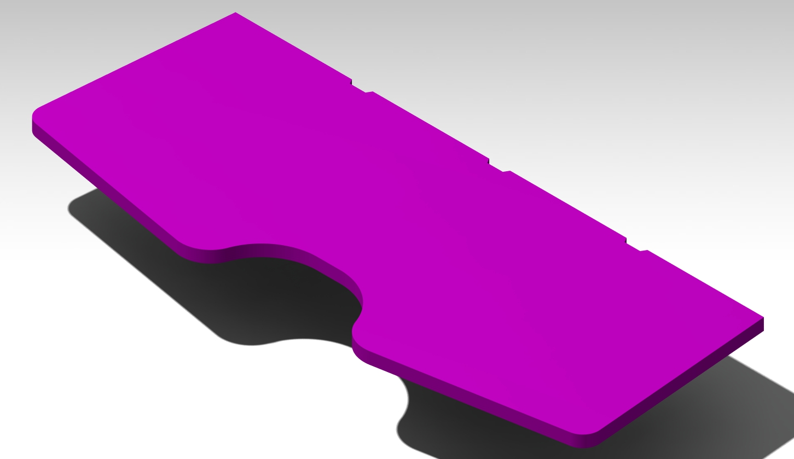
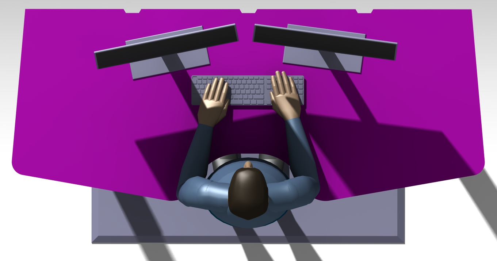
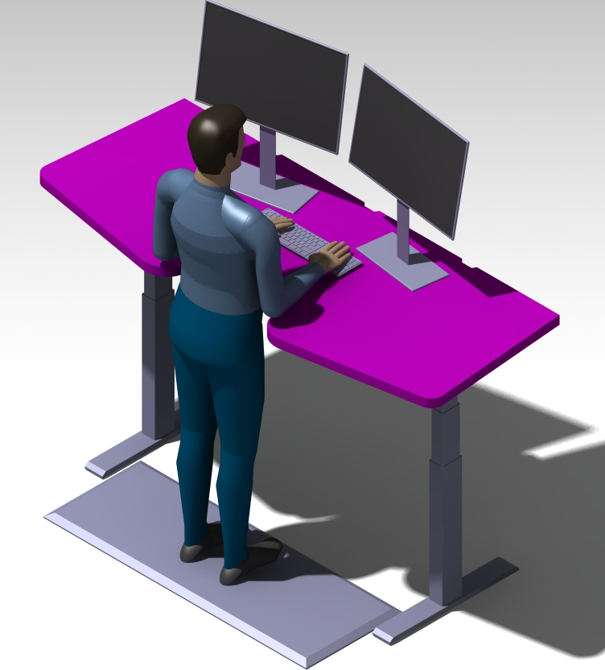
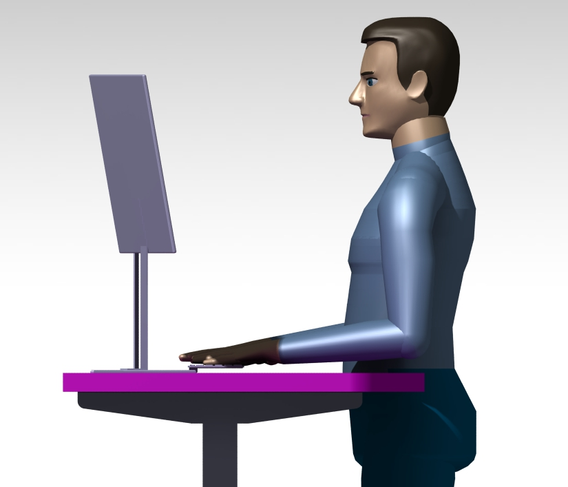
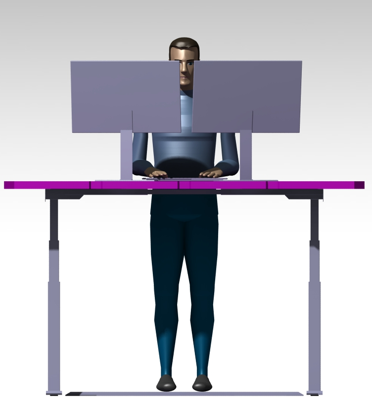
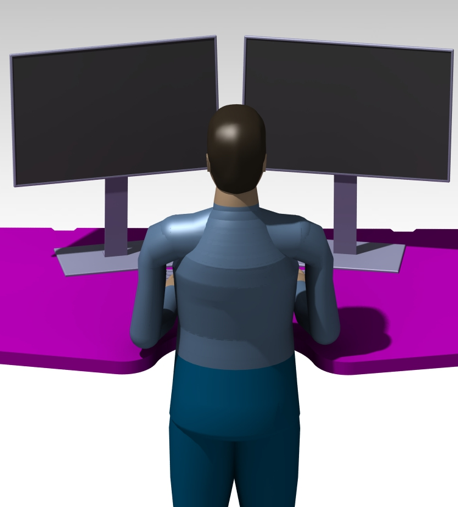

# TableTopVyborg
Столешница трапециевидной формы с эргономичным вырезом.

Трёхмерные модели и чертежи находятся в папке проекта `Документы`.

## Документы

Дополнительные изображения

Разработано специально для [StandCat](https://gitverse.ru/ekotov/StandCat)
